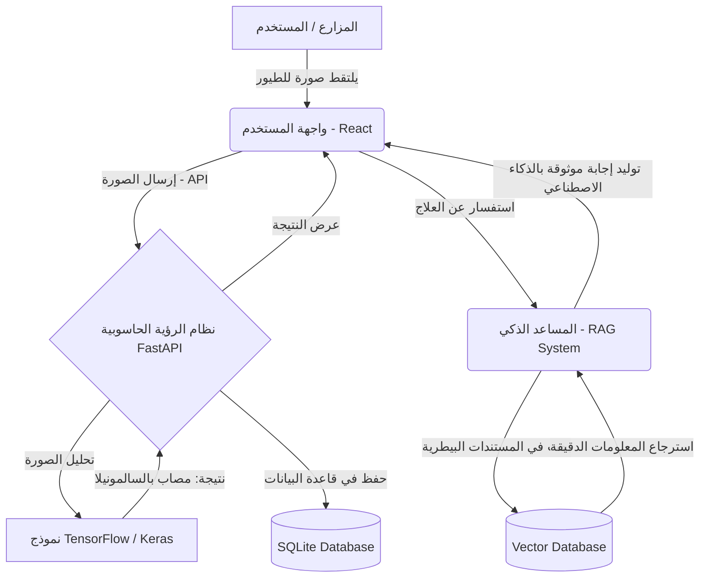

# الوصف الشامل لمشروع الرعاية الذكية للدواجن (Smart Poultry Care)

## 1. نظرة عامة على المشروع
**الرعاية الذكية للدواجن** هو نظام متكامل يعتمد على الذكاء الاصطناعي (AI) لمساعدة مزارعي الدواجن في إدارة قطعانهم واكتشاف الأمراض في مراحلها المبكرة. يجمع النظام بين تقنيات **الرؤية الحاسوبية (Computer Vision)** لتحليل الصور، ونظام **الاسترجاع المعزز بالتوليد (RAG)** لتقديم استشارات دقيقة وموثوقة.

---

## 2. المشكلة التي يحلها المشروع
صناعة الدواجن تواجه تحديات كبيرة، أبرزها:
- **الانتشار السريع للأمراض:** أمراض مثل (الكوكسيديا، السالمونيلا، ونيوكاسل) قد تدمر قطعاناً بأكملها في أيام معدودة إذا لم يتم اكتشافها مبكراً.
- **نقص الخبراء البيطريين:** لا يتوفر طبيب بيطري على مدار الساعة في العديد من المزارع.
- **التشخيص الخاطئ:** الاعتماد على الملاحظة البشرية فقط قد يؤدي إلى تأخر العلاج.
- **صعوبة اتخاذ القرار:** المزارعون يحتاجون إلى إجابات فورية حول كيفية التعامل مع تفشي مرض معين أو تحسين جودة القطيع.

**الهدف:** توفير أداة تقنية في متناول يد المزارع تعمل بمثابة "طبيب بيطري افتراضي"، قادرة على التشخيص الفوري وتقديم التوصيات العلاجية والوقائية.

---

## 3. التقنيات المستخدمة (Technical Stack)

تم بناء المشروع باستخدام بنية حديثة ومفصولة (Microservices Architecture) لضمان السرعة وقابلية التوسع:

### أ. واجهة المستخدم (Frontend)
- **React.js & Vite:** لبناء واجهة مستخدم تفاعلية وسريعة جداً.
- **TailwindCSS:** لتصميم واجهة عصرية ومريحة بصرياً (UI/UX).
- **Recharts:** لعرض إحصائيات لوحة التحكم (Dashboard) بطريقة مرئية.
- **React Router:** للتنقل بين الصفحات (لوحة التحكم، المساعد الذكي، المصادقة).

### ب. الواجهة الخلفية والذكاء الاصطناعي (Backend & AI)
- **FastAPI:** إطار عمل سريع جداً مبني بلغة Python، يستخدم لإنشاء واجهات برمجة التطبيقات (APIs).
- **TensorFlow & Keras:** لتشغيل نموذج الرؤية الحاسوبية (Deep Learning Model) المدرب على التعرف على الأمراض من الصور.
- **SQLAlchemy & SQLite:** لإدارة قواعد البيانات وتخزين معلومات القطعان (Flocks) وتاريخ التشخيصات (Predictions).
- **Uvicorn:** خادم ويب لتشغيل التطبيق (يعمل الأساسي على منفذ 8000، والـ RAG على منفذ 8001).

---

## 4. لماذا استخدمنا Computer Vision؟
تم استخدام **الرؤية الحاسوبية (CV)** وتحديداً نماذج التعلم العميق (Deep Learning) للأسباب التالية:
1. **التشخيص الفوري:** يمكن للمزارع التقاط صورة لفضلات الطيور أو الطائر المريض، وسيقوم النظام فوراً بتحليلها (Resize to 224x224) وتصنيفها إلى (سليم، كوكسيديا، نيوكاسل، أو سالمونيلا).
2. **الدقة العالية:** النماذج المدربة قادرة على ملاحظة أنماط دقيقة في الصور قد تغفل عنها العين البشرية.
3. **الاكتشاف المبكر (Early Detection):** التدخل السريع يقلل من نسب النفوق بشكل كبير.

---

## 5. لماذا استخدمنا RAG (Retrieval-Augmented Generation)؟
بدلاً من استخدام نموذج لغوي (LLM) عادي مثل ChatGPT، قمنا ببناء نظام **RAG (المساعد الذكي)** للرد على استفسارات المزارعين:
1. **منع الهلوسة (No Hallucinations):** النماذج اللغوية العادية قد تخترع علاجات غير صحيحة. نظام RAG يبحث أولاً في **قاعدة بيانات معرفية مخصصة** (كتب بيطرية، أبحاث دواجن موثوقة) ثم يصيغ الإجابة بناءً عليها.
2. **سياق مخصص:** عندما يسأل المزارع: "ما هو علاج الكوكسيديا؟"، يقوم النظام باسترجاع المعلومات الدقيقة للجرعات والأدوية من المستندات المعتمدة داخل النظام.
3. **تكامل مع التشخيص:** يمكن للمزارع أخذ نتيجة التشخيص من الـ Computer Vision وسؤال المساعد الذكي عن خطوات العزل والتعقيم.

---

## 6. الفوائد العائدة على المستخدم (المزارع/المستثمر)
- ✅ **تقليل الخسائر المالية:** الاكتشاف المبكر يمنع انتشار العدوى للقطيع بأكمله.
- ✅ **توفير الوقت والجهد:** لا حاجة لانتظار نتائج المختبر لأيام؛ النتيجة تظهر في ثوانٍ.
- ✅ **مستشار زراعي متاح 24/7:** الحصول على نصائح حول التغذية، الإضاءة، التهوية، وإدارة القطعان من خلال الـ Smart Assistant.
- ✅ **إدارة مركزية:** لوحة تحكم تتيح تتبع تاريخ الحالات الصحية للقطعان وإدارتها بكفاءة.

---

## 7. الخرائط التوضيحية (Diagrams)

### مخطط سير العمل (User Workflow)

### البنية التحتية للنظام (System Architecture)

---
*هذا المستند تم توليده آلياً بواسطة Antigravity AI بناءً على تحليل بنية المشروع الفعلي.*
