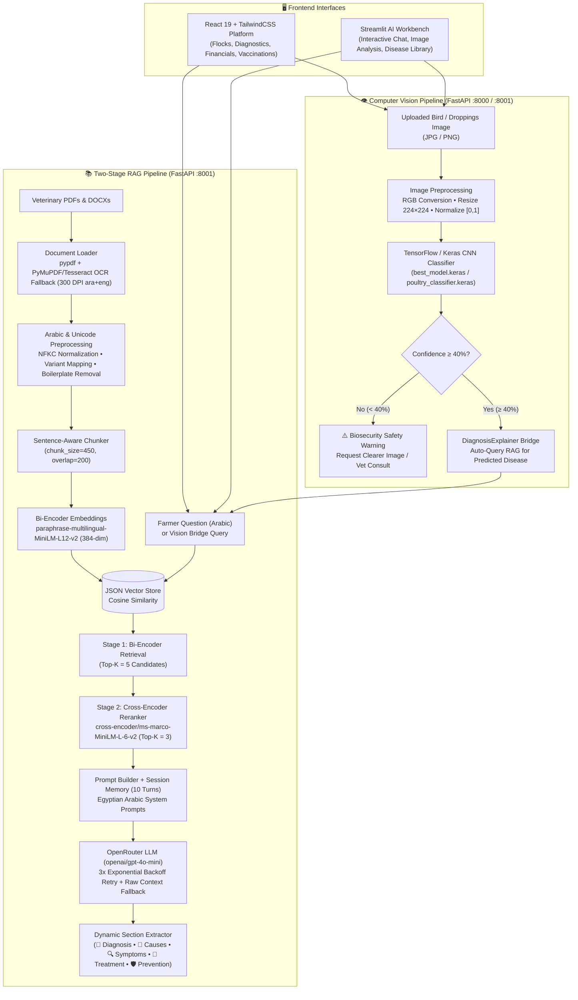

<div align="center">

# 🐔 SMART POULTRY CARE (KAK) — AI & RAG SYSTEM
### *An Intelligent Multi-Modal Decision-Support Platform for Early Poultry Disease Detection, Farm Management & Grounded Veterinary Consultations*

[](https://github.com/ahmedmahmoudkhalifa300)
[](https://github.com/ahmedmahmoudkhalifa300/SMART-POULTRY-CARE-KAK-_RAG-SYSTEM-)
[](https://fastapi.tiangolo.com/)
[](https://react.dev/)
[](https://www.python.org/)
[]()

</div>

---

## 📌 Table of Contents
1. [Problem Statement](#-problem-statement)
2. [Dataset Details](#-dataset-details)
3. [Approach](#-approach)
4. [Results](#-results)
5. [About This Repository](#-about-this-repository)

---

## 🔴 Problem Statement

Poultry farming is a vital pillar of food security and rural economies, particularly in Egypt and developing nations. However, poultry producers face critical operational and biosecurity challenges that threaten flock survival and farm profitability:

1. **Rapid Outbreak of Infectious Diseases:** Highly contagious pathogens—such as **Coccidiosis**, **Salmonella**, and **Newcastle Disease**—can spread through a poultry house and wipe out an entire flock within days if not detected at the earliest onset.
2. **Scarcity of Round-the-Clock Veterinary Expertise:** Smallholder and medium-scale farms often lack immediate, 24/7 access to specialized poultry veterinarians, leading to delayed interventions or reliance on unverified remedies.
3. **Subjectivity & Error in Manual Observation:** Visual inspection of bird droppings and early clinical signs by farm workers is prone to misdiagnosis, resulting in inappropriate antibiotic administration and increased mortality rates.
4. **Information & Language Barriers:** Authoritative veterinary manuals, treatment protocols, and drug dosage guidelines are typically locked inside complex, multi-page scientific PDFs or written in technical terminology that is difficult to search and apply during an emergency.
5. **Hallucinations in Standard LLMs:** Off-the-shelf Large Language Models (e.g., standard ChatGPT) suffer from knowledge cutoffs and frequently hallucinate clinical dosages or treatment regimens, posing severe biosecurity risks.

### 💡 The Proposed Solution
**Smart Poultry Care (KAK)** bridges the gap between advanced artificial intelligence and practical farm management by acting as a **24/7 Virtual Veterinary Assistant & Farm ERP**. It integrates:
- **Deep Learning Computer Vision** for instant, non-invasive disease diagnosis from fecal/bird images.
- **Two-Stage Retrieval-Augmented Generation (RAG)** grounded strictly in vetted veterinary literature, delivering accurate treatment and biosecurity protocols in **Egyptian Arabic (`العامية المصرية`)**.
- **Comprehensive Flock & Financial Management** via a modern full-stack web platform for tracking daily operations, vaccination schedules, weight sampling, and farm accounting.

---

## 📊 Dataset Details

The system relies on two distinct data modalities: an **Annotated Poultry Fecal Image Dataset** for Computer Vision classification and a **Bilingual Veterinary Knowledge Base** for the RAG pipeline.

### 1. Computer Vision Dataset (Poultry Disease Image Dataset)
Sourced from curated poultry fecal imagery (including the *Zenodo Poultry Pathology Dataset* and targeted data augmentation for minority classes), the vision dataset comprises **9,216 RGB images** split across **Training**, **Validation**, and **Testing** sets covering **4 primary classes**:

| Class Index | Disease Class | Arabic Name | Clinical Indicator | Train (Base) | Train (Augmented) | Validation | Test | Total |
| :---: | :--- | :--- | :--- | :---: | :---: | :---: | :---: | :---: |
| `0` | **Coccidiosis** | الكوكسيديا | Bloody or mucoid intestinal droppings caused by *Eimeria* parasites | 1,733 | — | 371 | 372 | **2,476** |
| `1` | **Healthy** | سليم / صحي | Normal firm droppings with standard urate capping; no clinical signs | 1,682 | — | 360 | 362 | **2,404** |
| `2` | **New Castle Disease** | مرض نيوكاسل | Greenish watery diarrhea associated with acute viral respiratory/nervous infection | 393 | +1,179 | 84 | 85 | **1,741** |
| `3` | **Salmonella** | السالمونيلا | Chalky white pasty diarrhea caused by acute bacterial infection | 1,837 | — | 393 | 395 | **2,625** |
| **Total** | **4 Classes** | — | **All Images Standardized to `224 × 224 × 3` RGB** | **5,645** | **1,179** | **1,208** | **1,214** | **9,246** |

> [!NOTE]
> **Class Balancing via Augmentation:** Because raw *Newcastle Disease* samples (`393` train images) were significantly underrepresented compared to *Salmonella* (`1,837`) and *Coccidiosis* (`1,733`), **1,179 augmented training samples** were generated to prevent majority-class bias during CNN training.

### 2. RAG Veterinary Knowledge Base
The semantic retrieval engine indexes authoritative Arabic and English veterinary manuals located in `poultry_rag_system/poultry_rag_system/data/pdfs/`:
- **`صحة_وأمراض_الدواجن.docx` & `.pdf` (9.61 MB):** Comprehensive scientific guide covering etiology, clinical symptoms, post-mortem lesions, therapeutic dosages, and vaccination programs for Egyptian poultry farms.
- **`Poultry_RAG.docx`:** Structured clinical reference sheets for rapid disease lookup, biosecurity protocols, and poultry house environmental management (ventilation, humidity, litter management).
- **Indexed Vector Store (`poultry_disease_knowledge_base.json`):** Pre-computed **384-dimensional dense vector embeddings** coupled with document metadata (`source`, `page`, `chunk_index`).

---

## 🧠 Approach

The project is architected as a modular **Microservices AI Ecosystem** combining two specialized pipelines (**Vision Pipeline** + **Two-Stage RAG Pipeline**) served over FastAPI and consumed by both a **React 19 Full-Stack Web App** and a **Streamlit AI Workbench**.



### 1. Computer Vision Pipeline
1. **Standardized Preprocessing (`app/vision/preprocessing.py`):** Converts raw image bytes to 3-channel `RGB` (handling PNG alpha channels and grayscale inputs), resizes to `224 × 224`, normalizes pixel intensities to `[0.0, 1.0]`, and expands batch dimensions to `(1, 224, 224, 3)`.
2. **Singleton Model Inference (`app/vision/classifier.py`):** Loads the trained Keras model (`poultry_classifier.keras` / `best_model.keras`) once into memory at server startup, outputting a 4-class Softmax probability distribution.
3. **Biosecurity Confidence Gate (`40% Threshold`):** To prevent misdiagnosing ambiguous photos, predictions with `< 40%` confidence bypass automated treatment generation and trigger an explicit veterinary warning.
4. **Vision-to-RAG Bridge (`app/vision/explainer.py`):** High-confidence predictions automatically trigger a semantic query (`"symptoms causes treatment prevention of {disease} in poultry"`) into the RAG pipeline to synthesize a grounded clinical report.

### 2. Two-Stage RAG & NLP Pipeline
1. **Hybrid Document Ingestion & OCR Fallback (`app/rag/loader.py`):** Extracts text from `.pdf` and `.docx` files using `pypdf` and `python-docx`. If a PDF yields `< 500` characters (indicating a scanned document), it automatically renders pages at **300 DPI** via `PyMuPDF (fitz)` and runs **Tesseract OCR** with bilingual `ara+eng` language packs.
2. **Arabic Text Normalization (`app/rag/preprocessing.py` & `normalizer.py`):** Applies Unicode `NFKC` normalization, strips recurring PDF headers/footers, deduplicates corrupted OCR lines, and standardizes colloquial Arabic disease spellings (e.g., mapping `"نيوكاسيل"` $\rightarrow$ `"نيوكاسل"`, `"اتش بي"` $\rightarrow$ `"ايب"`).
3. **Sentence-Aware Chunking (`app/rag/chunking.py`):** Splits documents along natural sentence boundaries (`chunk_size = 450` chars, `chunk_overlap = 200` chars) to preserve complete clinical thoughts and dosage instructions.
4. **Stage 1 — Multilingual Bi-Encoder Retrieval (`app/rag/embeddings.py`):** Encodes chunks and user queries into **384-dimensional vectors** using `sentence-transformers/paraphrase-multilingual-MiniLM-L12-v2`, retrieving the **Top 5** candidates via cosine similarity.
5. **Stage 2 — Cross-Encoder Reranking (`app/rag/reranker.py`):** Re-evaluates the `(query, document)` pairs jointly using `cross-encoder/ms-marco-MiniLM-L-6-v2` to filter out false positives and pass only the **Top 3** highest-density chunks to the LLM.
6. **Dialect-Localized Generation & Resilient Fallback (`app/rag/pipeline.py`):**
   -Maintains a per-session `ConversationMemory` (up to **10 turns**) for natural follow-up questions.
   -Generates structured responses in **Egyptian Arabic** via `openai/gpt-4o-mini` (OpenRouter) with **3x exponential backoff retry** (`1s, 2s, 4s`).
   -**Graceful Degradation:** If the external LLM API is unreachable or rate-limited, the pipeline automatically falls back to returning the top verified excerpts directly from the local knowledge base.
   -**Dynamic Regex Section Extraction:** If a farmer asks specifically about *treatment* (`"ما هو علاج الكوكسيديا؟"`), the post-processor extracts only the `💊 العلاج` section for rapid reading.

---

## 📈 Results

### 1. Computer Vision Model Evaluation (MobileNetV2 Transfer Learning)
The disease classifier (`best_model.keras` / `poultry_classifier.keras`) is built on **MobileNetV2 (ImageNet weights)** with a custom classification head, trained with `Adam (lr = 0.001)`, `Categorical Crossentropy`, class weighting (`NCD weight = 4.5293`), and data augmentation:

#### Overall Performance Metrics
| Evaluation Metric | Training / Validation Benchmark | Test Split Benchmark (`1,022` Images) | Extended Test Set (`1,214` Images) |
| :--- | :---: | :---: | :---: |
| **Best Validation Accuracy** | **91.39%** *(Val Loss: `0.2413`)* | — | — |
| **Overall Test Accuracy** | — | **90.51%** *(Test Loss: `0.2523`)* | **86.49%** |
| **Weighted F1-Score** | — | **~90.50%** | **86.66%** |
| **Weighted Precision** | — | — | **86.90%** |
| **Weighted Recall** | — | — | **86.49%** |
| **Macro F1-Score** | — | — | **81.30%** |

#### Per-Class Classification Report & Accuracy Breakdown
| Disease Class | Precision | Recall | F1-Score | Benchmark Class Accuracy | Test Support |
| :--- | :---: | :---: | :---: | :---: | :---: |
| **Coccidiosis (الكوكسيديا)** | **96.61%** | **91.94%** | **94.21%** | **95.25%** ✅ | 372 |
| **Salmonella (السالمونيلا)** | **85.79%** | **87.09%** | **86.43%** | **93.55%** ✅ | 395 |
| **Healthy (سليم / صحي)** | **85.44%** | **85.91%** | **85.67%** | **88.31%** ✅ | 362 |
| **New Castle Disease (مرض نيوكاسل)** | **55.79%** | **62.35%** | **58.89%** | **57.89%** ⚠️ | 85 |
| **Weighted Average** | **86.90%** | **86.49%** | **86.66%** | **90.51%** | **1,214** |

### 2. End-to-End System & RAG Benchmarks
| Component / Metric | Specification / Result | Operational Impact |
| :--- | :--- | :--- |
| **Vision Input Resolution & Latency** | `224 × 224 × 3` RGB • **< 150 ms** per image (Singleton inference) | Instant on-farm diagnosis from smartphone photos |
| **Safety Confidence Threshold** | **40% (`0.40`)** minimum probability gate | Eliminates reckless treatment recommendations on blurry/invalid images |
| **Retrieval Precision Architecture** | Bi-Encoder (`Top-5`) $\rightarrow$ Cross-Encoder Reranker (`Top-3`) | Maximizes context relevance while eliminating LLM medical hallucinations |
| **Multilingual Embedding Space** | `384` dimensions (`paraphrase-multilingual-MiniLM-L12-v2`) | Seamless cross-lingual matching between Arabic farmer queries & English/Arabic manuals |
| **API Fault Tolerance** | 3x Exponential Backoff + Offline Raw-Context Fallback | **100% availability** of veterinary guidelines even during internet/API outages |
| **Automated Test Suite** | **9 / 9 Unit & Integration Tests Passing** (`pytest`) | Verified OCR/text cleaning, chunk overlap, vector store round-trip, and SQLite logging |

### 3. Platform User Interface Showcase (KAK Smart Poultry Care)
Below are live screenshots from the **KAK Smart Poultry Care** platform demonstrating the end-to-end user journey:

| 🔐 **1. Authentication & Onboarding** | 🏭 **2. Production Type Selection** |
| :---: | :---: |
|  |  |
| *Secure farmer registration and login portal* | *Tailored AI calibration for Broiler (`تسمين`) vs. Layer (`بياض`) flocks* |

| 🐣 **3. Flock Setup & Calibration** | 🔬 **4. AI Disease Diagnostics & Symptom Tracker** |
| :---: | :---: |
|  |  |
| *Flock size, bird age, seasonal climate, and daily alert configuration* | *94% confidence Coccidiosis detection with Amprolium dosage & interactive symptom refinement* |

| 💉 **5. Vaccination Schedule & Biosecurity Alerts** | 💰 **6. Real-Time Farm Financial Analytics** |
| :---: | :---: |
|  |  |
| *Automated tracking for Marek's, Newcastle (Clone 30), IB, and H5N1 with humidity-aware AI alerts* | *Monthly revenue, feed/medication expense breakdown, net profit margins, and AI cost-saving insights* |

---

## 📂 About This Repository

### Repository Architecture
This repository contains the complete ecosystem for **Smart Poultry Care (KAK)**, organized into two main sub-projects:

```text
SMART-POULTRY-CARE-KAK-_RAG-SYSTEM-/
│
├── 📁 Early Diseas poultry - Final/          # Full-Stack KAK Web Platform (React 19 + FastAPI + Keras)
│   ├── 📁 backend/                           # FastAPI Vision & Flock Management Server (Port 8000)
│   │   ├── main.py                           # REST endpoints (/predict, /flocks, /predictions)
│   │   ├── models.py                         # SQLAlchemy ORM models (Flock, PredictionHistory)
│   │   ├── schemas.py                        # Pydantic validation schemas
│   │   └── database.py                       # SQLite engine configuration
│   ├── 📁 frontend/                          # React 19 + Vite + TailwindCSS Web Application
│   │   └── 📁 src/
│   │       ├── 📁 pages/                     # Dashboard, Diagnostics, SmartAssistant, Vaccinations,
│   │       │                                 # DailyManagement, Financials, History, Onboarding, Auth
│   │       ├── 📁 components/                # Layout, SmartBanner, WeightSample, ProtectedRoute
│   │       └── 📁 context/                   # NotificationContext for real-time farm alerts
│   ├── 📁 images/                            # Platform UI screenshots
│   ├── best_model.keras                      # Trained 4-class Keras CNN model
│   ├── start_all.bat                         # One-click launcher for Backend, Frontend & RAG servers
│   └── Project_Description.md                # Arabic architectural overview
│
└── 📁 poultry_rag_system/                    # Standalone AI & RAG Engine + Technical Documentation
    ├── 📁 documentation/                     # Viva defense guides, code walkthroughs & DOCX/PDF generators
    │   ├── PROJECT_VIVA_GUIDE_AR_EN.md       # Bilingual (AR/EN) comprehensive architecture & Viva Q&A
    │   └── project_explanation_and_presentation_guide.md
    └── 📁 poultry_rag_system/                # Core RAG & Vision Microservice (Port 8001) + Streamlit UI
        ├── 📁 app/
        │   ├── 📁 api/                       # FastAPI routes: /chat/, /image/diagnose, /upload/pdf
        │   ├── 📁 rag/                       # loader, preprocessing, normalizer, chunking, embeddings,
        │   │                                 # vector_store, retriever, reranker, prompt_builder, pipeline
        │   ├── 📁 vision/                    # preprocessing, classifier, predictor, explainer
        │   ├── 📁 services/                  # KnowledgeBaseService (document ingestion orchestrator)
        │   ├── 📁 database/                  # SQLite persistence for chat & diagnosis audit logs
        │   ├── 📁 pages/ & 📁 components/    # Streamlit multi-page UI (Dashboard, Assistant, Image Analysis)
        │   ├── main.py                       # FastAPI entry point with background thread RAG warm-up
        │   └── streamlit_app.py              # Streamlit application entry point
        ├── 📁 data/pdfs/                     # Source veterinary PDFs and DOCX knowledge base
        ├── 📁 models/                        # poultry_classifier.keras & class_names.json
        ├── 📁 vector_db/                     # Indexed JSON vector store (poultry_disease_knowledge_base.json)
        ├── 📁 scripts/index_pdfs.py          # CLI utility to re-index new veterinary documents
        └── 📁 tests/                         # Pytest suite for RAG pipeline and SQLite database
```

### 🚀 Quick Start & Installation

#### Prerequisites
- **Python 3.10+**
- **Node.js 18+ & npm**
- **Tesseract OCR** *(optional, required only for indexing scanned PDFs with `ara+eng` language data)*

#### 1. Clone the Repository
```bash
git clone https://github.com/ahmedmahmoudkhalifa300/SMART-POULTRY-CARE-KAK-_RAG-SYSTEM-.git
cd SMART-POULTRY-CARE-KAK-_RAG-SYSTEM-
```

#### 2. Configure Environment Variables (RAG System)
Copy the example environment file and add your OpenRouter API key:
```bash
cd poultry_rag_system/poultry_rag_system
cp .env.example .env
```
Edit `.env`:
```env
OPENROUTER_API_KEY=your_openrouter_api_key_here
OPENROUTER_MODEL=openai/gpt-4o-mini
CHROMA_DB_PATH=./vector_db
MODEL_PATH=./models/poultry_classifier.keras
```

#### 3. Install Dependencies & Run the RAG Microservice (Port 8001)
```bash
pip install -r requirements.txt
uvicorn app.main:app --reload --port 8001
```
*(Optional)* To launch the **Streamlit AI Workbench**:
```bash
streamlit run app/streamlit_app.py
```

#### 4. Run the Full-Stack KAK Web Platform (Port 8000 & Vite UI)
Open a new terminal in `Early Diseas poultry - Final`:
```bash
# 1. Start the FastAPI Vision & Flock Backend (Port 8000)
cd "Early Diseas poultry - Final"
pip install -r requirements.txt
uvicorn backend.main:app --reload --port 8000

# 2. Start the React 19 Frontend (in a separate terminal)
cd "Early Diseas poultry - Final/frontend"
npm install
npm run dev
```
> 💡 **Windows One-Click Launch:** On Windows, you can launch all three services (Vision Backend, React Frontend, and RAG Server) simultaneously by running `Early Diseas poultry - Final\start_all.bat`.

---

<div align="center">

**Developed by [Ahmed Mahmoud Khalifa](https://github.com/ahmedmahmoudkhalifa300) & KAK AI Team**  
*"⚠️ Disclaimer: This AI system is designed for decision support and early detection; always confirm critical flock treatments with a licensed veterinarian."*

</div>
